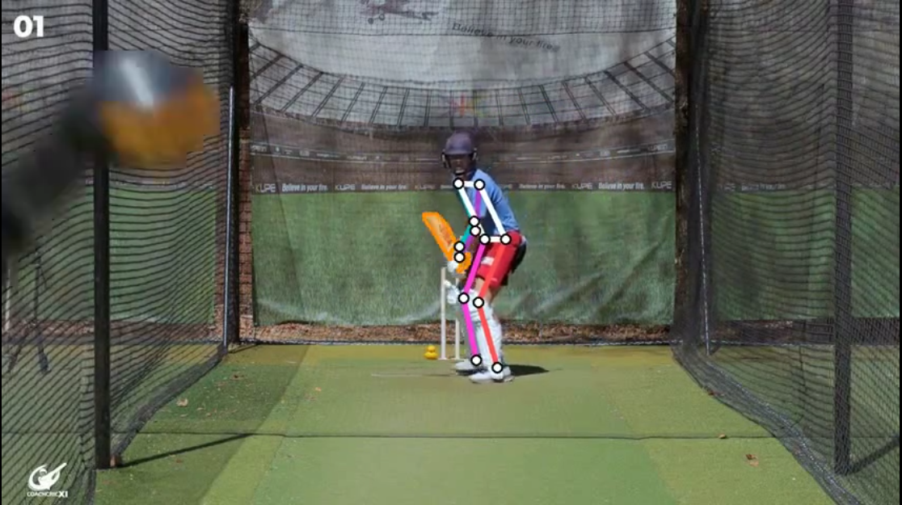
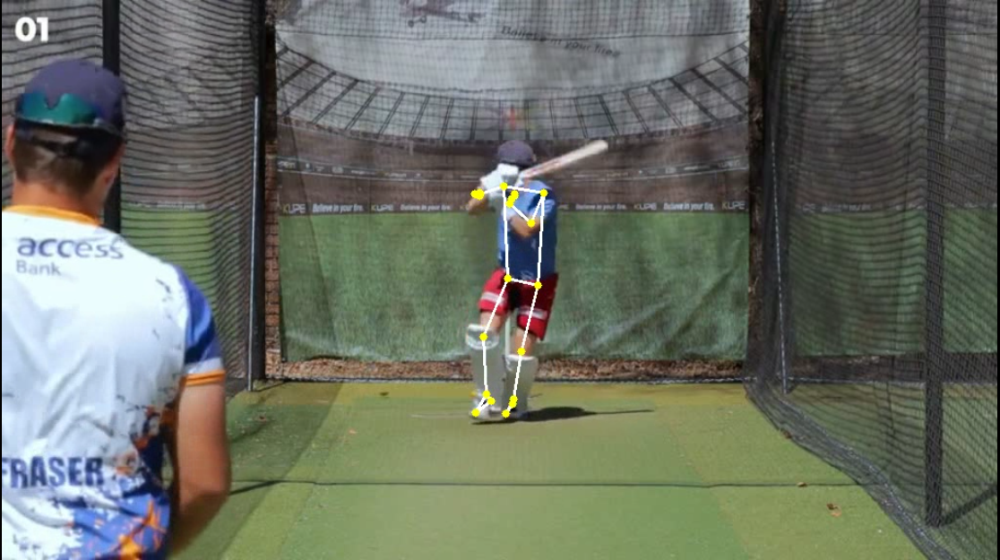

# 🏏 VisionCoach — Cricket Batter Pose & Bat Analysis

VisionCoach is a computer vision project for analyzing cricket batting footage. It compares a lightweight MediaPipe pose pipeline with a higher-accuracy notebook pipeline that combines:

- **RT-DETR** for person detection
- **ViTPose+ Large** for 17-point COCO pose estimation
- **YOLOv11-seg** for bat segmentation
- **Temporal post-processing** for smoother joints and more stable bat tracking

## Results

| Stance and backlift | Downswing and alignment |
| --- | --- |
|  |  |

## Repository contents

```text
.
├── assets/
│   ├── screen1.png                 # Example output image
│   └── screen2.png                 # Example output image
├── cricket-pose-estimation-using-vitepose.ipynb
│                                  # Kaggle-oriented ViTPose + YOLO pipeline
├── google_media_pipe.py           # Standalone MediaPipe Pose pipeline
├── pose_landmarker_full.task      # Bundled MediaPipe pose model
├── models/vitpose-plus-large/     # Local ViTPose model metadata
├── outputs/                       # Generated MediaPipe videos
├── requirments.txt                # Python package requirements
├── test_swing.mp4                 # Example input video
└── README.md
```

> **Note:** `requirments.txt` is the repository's actual filename. The filename is misspelled because it uses `requirments` rather than `requirements`.

## Approaches

### MediaPipe baseline

The standalone `google_media_pipe.py` script processes `test_swing.mp4` with MediaPipe Pose Landmarker. It:

- Resizes frames to 1024 × 576
- Detects one pose per frame
- Removes face landmarks from the rendered skeleton
- Saves the annotated result to `outputs/test_swing_pose_only.mp4`
- Downloads `pose_landmarker_full.task` automatically only if it is not already present

### ViTPose+ and bat segmentation pipeline

`cricket-pose-estimation-using-vitepose.ipynb` is the main two-pass analysis pipeline:

1. **Detection:** RT-DETR (`PekingU/rtdetr_r50vd_coco_o365`) locates people.
2. **Pose estimation:** ViTPose+ Large (`usyd-community/vitpose-plus-large`) extracts 17 COCO keypoints.
3. **Bat segmentation:** YOLOv11-seg detects and segments the bat in frame with a wrist-guided hold mechanism.
4. **Temporal cleanup:** The notebook filters outliers, closes short missing-keypoint gaps, and applies Gaussian smoothing.
5. **Rendering:** It overlays the skeleton and bat mask and encodes the result as H.264-compatible output.

The notebook is configured for Kaggle paths and CUDA, but it can run on CPU as a fallback. GPU execution is strongly recommended for practical performance.

## Installation

### 1. Clone and enter the repository

```bash
git clone https://github.com/<your-username>/VisionCoach---The-Batter-Analyzer-.git
cd VisionCoach---The-Batter-Analyzer-
```

### 2. Create a virtual environment

```bash
python -m venv .venv
source .venv/bin/activate
```

On Windows, activate the environment with:

```powershell
.venv\Scripts\activate
```

### 3. Install dependencies

The repository currently provides a misspelled requirements filename:

```bash
python -m pip install --upgrade pip
python -m pip install -r requirments.txt
python -m pip install mediapipe requests
```

For MediaPipe only, the core packages are:

```bash
python -m pip install opencv-python mediapipe numpy requests
```

For Jupyter or Kaggle notebook usage:

```bash
python -m pip install -q transformers ultralytics opencv-python torch torchvision
```

## Run the MediaPipe baseline

From the repository root, place or keep `test_swing.mp4` in the root folder and run:

```bash
python google_media_pipe.py
```

The annotated video is written to:

```text
outputs/test_swing_pose_only.mp4
```

## Run the ViTPose+ notebook

1. Open `cricket-pose-estimation-using-vitepose.ipynb` in Jupyter, VS Code, or Kaggle.
2. Set the notebook accelerator to a GPU if using Kaggle.
3. Update `VIDEO_IN` to point to the input video.
4. Run the cells from top to bottom.
5. Download or open the path assigned to `VIDEO_OUT`.

The notebook expects this Kaggle-style input format by default:

```text
/kaggle/input/datasets/malikahmadrasheed223/test-swing/test_swing.mp4
```

For local use, change it to a local path such as:

```python
VIDEO_IN = "test_swing.mp4"
RAW_OUT = "outputs/raw.mp4"
VIDEO_OUT = "outputs/batter_final.mp4"
```

## Main notebook settings

These settings are defined near the top of the notebook:

| Setting | Default | Purpose |
| --- | --- | --- |
| `BATTER_ROI` | `(0.28, 0.00, 0.78, 1.00)` | Restricts detection to the batter region |
| `POSE_MODEL` | `usyd-community/vitpose-plus-large` | ViTPose+ model checkpoint |
| `THRESH` | `0.35` | Minimum pose-keypoint confidence |
| `GAP_MAX` | `15` | Maximum short missing-keypoint gap to interpolate |
| `SIGMA` | `1.15` | Temporal Gaussian smoothing strength |
| `SEGMENT_BAT` | `True` | Enables bat segmentation |
| `YOLO_MODEL` | `yolo11m-seg.pt` | YOLOv11-seg checkpoint |
| `YOLO_IMGSZ` | `1280` | Segmentation inference resolution |
| `BAT_CONF` | `0.04` | Bat segmentation confidence threshold |
| `BAT_HOLD` | `4` | Frames to retain/rotate a bat mask after a missed detection |
| `TRACK_BALL` | `False` | Optional ball tracking feature |

## FFmpeg

The notebook can use FFmpeg to produce a standard H.264 `.mp4`. Install it with:

```bash
# Ubuntu / Debian
sudo apt update
sudo apt install ffmpeg

# macOS
brew install ffmpeg

# Windows
winget install Gyan.FFmpeg
```

Verify the installation:

```bash
ffmpeg -version
```

## Model and package downloads

The first notebook run may download model weights from Hugging Face and may download the YOLO checkpoint. Keep a network connection available and allow enough disk space for the downloaded models. The MediaPipe script uses the existing local `pose_landmarker_full.task` model and falls back to downloading it only when the file is absent.

## Limitations

- A transformer pose model and YOLO segmentation require substantially more compute than MediaPipe.
- Bat segmentation quality depends on camera angle, resolution, lighting, and occlusion.
- Results should be interpreted as an analysis aid, not an official biomechanical assessment.
- The standalone MediaPipe script is a baseline implementation and does not include the notebook's bat segmentation or temporal filtering pipeline.